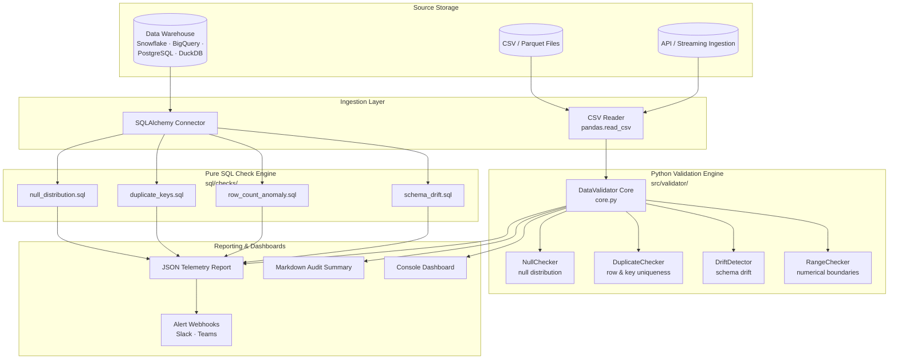

# Data Quality Validator (`v1.0.0`)

[](https://github.com/bighnaraj2008-ai/data-quality-validator/actions/workflows/ci_validation.yml)
[](https://github.com/bighnaraj2008-ai/data-quality-validator/actions/workflows/sql_lint.yml)
[](https://github.com/bighnaraj2008-ai/data-quality-validator/actions/workflows/benchmarks.yml)
[](https://github.com/bighnaraj2008-ai/data-quality-validator/actions/workflows/docs_check.yml)
[](#)
[](https://www.python.org/)
[](https://opensource.org/licenses/MIT)
[](https://github.com/psf/black)
[](https://github.com/bighnaraj2008-ai/data-quality-validator/releases)
[](#)
[](#)
[](#)

A high-performance, modular data validation and quality assurance framework designed for modern data engineering pipelines.

## Overview

`data-quality-validator` delivers declarative, automated data quality testing for data ingestion and ETL/ELT pipelines. It provides dual-mode validation:
- **In-Memory Engine**: High-throughput validation across Pandas / PyArrow dataframes.
- **In-Database SQL Engine**: Pure SQL check templates for direct execution in data warehouses (Snowflake, BigQuery, PostgreSQL, DuckDB, SQLite).

---

## Table of Contents

1. [Overview](#overview)
2. [Architecture & Data Flow](#architecture--data-flow)
3. [Declarative Rule Authoring](#declarative-rule-authoring)
4. [Pure SQL Check Catalog](#pure-sql-check-catalog)
5. [Quickstart Guide & Benchmarking](#quickstart-guide)
6. [Production Utility Scripts](#production-utility-scripts)
7. [Code Style, Linting & CI Automation](#code-style-linting--ci-automation)
8. [Python API Reference](#python-api-reference)
9. [Troubleshooting & Diagnostics](#troubleshooting--diagnostics)
10. [Project Status & Roadmap](#project-status--roadmap)
11. [Contributing, License & Security](#contributing)
12. [Repository Documentation Index](#repository-documentation-index)

### Key Features
- **Null Value Inspection**: Quantifies missing data against configurable threshold ratios.
- **Duplicate Detection**: Identifies row-level duplicates and candidate primary key collisions.
- **Schema Drift Monitoring**: Detects missing columns, unmapped additions, and data type shifts.
- **Range & Boundary Verification**: Validates numerical bounds and statistical bounds.
- **Declarative YAML Rules**: Flexible configuration with environment variable override support.
- **Audit Reports**: Produces machine-readable JSON metrics and markdown summaries.

---

## Architecture & Data Flow

Datasets flow from source storage through Python validators and pure SQL check engines to final reporting dashboards.

### Component Diagram



For full sequence diagrams and detailed architectural notes, see [`docs/ARCHITECTURE.mmd`](docs/ARCHITECTURE.mmd) and [`docs/ARCHITECTURE_REFACTOR.md`](docs/ARCHITECTURE_REFACTOR.md).

---

## Declarative Rule Authoring

Validation rules are authored in clean, declarative YAML format. Rules configure check thresholds, non-nullable assertions, uniqueness keys, and webhook targets.

```yaml
version: "1.0"
environment: "production"

thresholds:
  default_null_threshold: 0.05
  strict_schema: true
  allow_duplicates: false

rules:
  null_checks:
    non_nullable: [id, email]
    column_thresholds:
      phone_number: 0.20
  ranges:
    age:
      min: 0
      max: 120
```

For full syntax reference, per-column overrides, severity mapping, and alert webhook setup, see the [Rule Authoring Guide](docs/RULE_AUTHORING.md).

---

## Pure SQL Check Catalog

When validating datasets exceeding RAM limits or residing directly in cloud data warehouses, `data-quality-validator` provides parameter-bound SQL check templates under `sql/checks/`.

| Check Name | SQL Template | Detects |
|:-----------|:-------------|:--------|
| Null Distribution | `null_distribution.sql` | Missing value ratios exceeding thresholds |
| Primary Key Uniqueness | `duplicate_keys.sql` | Duplicate primary keys and composite key collisions |
| Row Count Anomaly | `row_count_anomaly.sql` | Record count deviations outside expected min/max |
| Schema Drift | `schema_drift.sql` | Missing columns, unmapped additions, and type mismatches |

For query templates, dialect compatibility matrices (Postgres, SQLite, Snowflake, BigQuery, DuckDB), and execution examples, see the [Pure SQL Check Catalog](docs/SQL_CHECK_CATALOG.md) and [SQL Checks Guide](docs/SQL_CHECKS_GUIDE.md).

---

## Documentation Directory & Guides

| Document | Topic | Description |
|:---------|:------|:------------|
| [Rule Authoring Guide](docs/RULE_AUTHORING.md) | Configuration | Declarative YAML syntax, threshold parameters, alert webhooks |
| [Pure SQL Check Catalog](docs/SQL_CHECK_CATALOG.md) | Database Checks | SQL check templates across Postgres, Snowflake, BigQuery, SQLite |
| [System Architecture](docs/ARCHITECTURE.mmd) | Design | Sequence flows and component diagrams |
| [API Reference](docs/API_REFERENCE.md) | Python API | Core classes, checkers, and config loader interfaces |
| [Deployment Runbook](docs/DEPLOYMENT_GUIDE.md) | Operations | Containerization, Kubernetes CronJobs, Airflow DAGs |
| [Release Process Runbook](docs/RELEASE_PROCESS.md) | Operations | Semantic version bumping, tagging, and PyPI/GitHub releases |
| [Production Checklist](docs/PRODUCTION_CHECKLIST.md) | Operations | Pre-production readiness verification checklist |
| [Report Archive Policy](docs/ARCHIVE_POLICY.md) | Operations | Failure extraction, log rotation, and retention tiers |
| [Diagnostics Playbook](docs/DIAGNOSTICS.md) | Troubleshooting | Isolating failed checks and SQL forensics queries |
| [Security Hardening](docs/SECURITY_HARDENING.md) | Security | Credential protection and least-privilege roles |
| [Schema Migration Guide](docs/MIGRATION_V2.md) | Upgrades | Upgrading from rule schema v1.0 to v2.0 |
| [Data Governance Guide](docs/DATA_GOVERNANCE.md) | Compliance | Data lineage, audit trails, and privacy compliance |
| [Contributing Guide](docs/CONTRIBUTORS_GUIDE.md) | Development | Submitting custom checkers and pull requests |

---

## Quickstart Guide

### 1. Installation

```bash
git clone https://github.com/bighnaraj2008-ai/data-quality-validator.git
cd data-quality-validator

python -m venv venv
# Linux / macOS
source venv/bin/activate
# Windows PowerShell
.\venv\Scripts\Activate.ps1

pip install -e .
```

### 2. Running Data Validation

```bash
# Validate dataset against YAML configuration
python scripts/run_validation.py --data sample_data.csv --config src/config/validator_config.yaml

# Generate JSON execution telemetry report
python scripts/generate_report.py --input sample_data.csv --output reports/validation_report.json --format json
```

### 3. Running Unit Tests

```bash
pytest tests/ -v
```

### 4. Performance Benchmarking

Run the check-execution throughput and latency harness under heavy
multi-column anomaly detection loads to measure rows-per-second processing
capacity and per-check p50/p95 latency:

```bash
# Benchmark 1k / 10k / 50k / 100k rows, 3 iterations each
python tests/benchmarks/bench_validator.py --rows 1000 10000 50000 100000 --iterations 3

# Write machine-readable telemetry for CI dashboards and data engineering
python tests/benchmarks/bench_validator.py --rows 50000 --output reports/benchmark_telemetry.json

# Measure heap memory allocation profile
python tests/benchmarks/bench_memory.py --rows 1000 10000 50000
```

The harness emits a telemetry table (quality score, throughput in rows/s,
check latency p50/p95, and per-check status) and exits non-zero if throughput
falls below the acceptable floor or any check errors out. Benchmark results
are documented in [`docs/BENCHMARK_RESULTS.md`](docs/BENCHMARK_RESULTS.md) and [`docs/BENCHMARK_REPORT.md`](docs/BENCHMARK_REPORT.md).

---

## Production Utility Scripts

| Script | Purpose |
|:-------|:--------|
| `scripts/export_reports.py` | Export validation failure logs into structured CSV or JSON archives for data engineering pipelines. |
| `scripts/prune_reports.py` | Report rotation and historical validation log pruning (max-age, keep-latest, dry-run controls). |
| `scripts/generate_telemetry_report.py` | Generate Markdown executive telemetry summaries from JSON reports. |

### Export Failure Reports

```bash
# Export all FAIL/ERROR check records from a single report
python scripts/export_reports.py --input reports/validation_report.json --output archives/failures.csv --format csv

# Export from every report in a directory, then archive the sources
python scripts/export_reports.py --input reports/ --output archives/failures.json --format json --statuses FAIL,ERROR --archive-dir reports/processed
```

### Prune Historical Reports

```bash
# Inspect what would be pruned without deleting anything
python scripts/prune_reports.py --reports-dir reports/ --max-age-days 30 --keep-latest 50 --min-keep 10 --dry-run

# Execute report rotation
python scripts/prune_reports.py --reports-dir reports/ --max-age-days 30 --keep-latest 50 --min-keep 10
```

---

## Code Style, Linting & CI Automation

All Python and SQL changes are gated by `flake8`, `black`, and `sqlfluff`:

```bash
# Run all Python and SQL static analysis checks
./scripts/run_linter.sh

# Preview formatting changes without modifying files
./scripts/check_formatting.sh

# Auto-format Python modules and SQL check templates
./scripts/format_code.sh
```

See the [CI/CD Pipeline Architecture](docs/CI_CD_PIPELINE.md) and [Linter Standards Guide](docs/LINTER_STANDARDS.md) for rule details.

---

## Python API Reference

Embed `data-quality-validator` directly into your data pipelines and ETL scripts:

```python
import pandas as pd
from src.validator.core import DataValidator
from src.config.loader import ConfigLoader

# Load declarative rules with environment overrides
config = ConfigLoader.load("src/config/validator_config.yaml")

# Initialize orchestrator
validator = DataValidator(config=config)

# Execute checks
df = pd.read_csv("sample_data.csv")
report = validator.validate(df, dataset_name="orders_landing")

print(f"Status: {report.overall_status.value}")
print(f"Passed: {len(report.passed_checks)} | Failed: {len(report.failed_checks)}")
```

For complete class hierarchies, method signatures, and exceptions, see the [Python API Reference](docs/API_REFERENCE.md).

---

## Troubleshooting & Diagnostics

- **Dynamic Threshold Overrides:** Override rules at runtime without modifying files using `DQ_` environment variables (e.g. `export DQ_NULL_THRESHOLD=0.10`).
- **Debugging Failures:** Consult the [Diagnostics Playbook](docs/DIAGNOSTICS.md) for isolating offending records and SQL forensics queries.
- **Incident Response:** See the [Incident Playbook](docs/INCIDENT_PLAYBOOK.md) for severity classifications and circuit breaker protocols.
- **CI/CD Build Issues:** Check the [CI/CD Troubleshooting Guide](docs/TROUBLESHOOTING_CI.md) for linter and matrix build fixes.
- **CI/CD Automation FAQ:** Read the [CI/CD & Linter Automation FAQ](docs/FAQ_AUTOMATION.md).
- **Common Questions:** Review the [Frequently Asked Questions](docs/FAQ.md) for quick answers.

---

---

## Project Status & Roadmap

- **Day 1 Milestone Completed** :white_check_mark:
  - Architecture decoupled into isolated modular checkers (`null`, `duplicate`, `drift`, `range`).
  - YAML configuration loader with dynamic environment variable overrides.
  - Pure SQL check template library initialized.
  - Comprehensive unit test suite with 100% pass rate.
  - CI workflows configured with SQLFluff and Pytest.
- **Day 2 Milestone Completed** :white_check_mark:
  - Standardized fixture catalog and modular edge-case test suites.
  - End-to-end integration and pure SQL check verification suites.
  - Performance benchmarks (> 10,000 rows/s) and memory profiling (< 60 MB).
  - Documentation guides (`TEST_COVERAGE.md`, `EDGE_CASES.md`, `FIXTURE_GUIDE.md`, `BENCHMARK_TEMPLATE.md`).
- **Day 3 Milestone Completed** :white_check_mark:
  - Advanced documentation architecture and comprehensive runbook guides.
  - Pure SQL check catalog covering nulls, uniqueness, row count anomaly, and drift.
  - Interactive Mermaid sequence and component architecture diagrams.
  - Automated documentation link validator and CI integration workflow.
- **Day 4 Milestone Completed** :white_check_mark:
  - Multi-version GitHub Actions CI matrix (Python 3.9-3.12) with automated coverage and JUnit reporting.
  - Strict Python (`black`, `flake8`) and ANSI SQL (`sqlfluff`) static analysis workflows and local helper scripts.
  - Automated security (`bandit`, `pip-audit`, `CodeQL`), dependency validation, Dependabot, and release packaging pipelines.
  - Complete CI/CD architecture, linter standards, release runbook, and troubleshooting documentation.
- **Day 5 Milestone Completed** :white_check_mark:
  - Throughput & latency benchmarking harness (`tests/benchmarks/bench_validator.py`) & memory profiler (`tests/benchmarks/bench_memory.py`).
  - Report archival & rotation suite (`scripts/export_reports.py`, `scripts/prune_reports.py`, `scripts/generate_telemetry_report.py`).
  - Automated benchmark CI workflow (`.github/workflows/benchmarks.yml`) and 24-hour stability stress suite.
  - Final production readiness checklist, archive policy, and `v1.0.0` release lock-in.
- **Upcoming Day 6 Milestone**:
  - Cloud warehouse direct adapters (Snowflake, BigQuery) and parallel asynchronous execution.

---

## Acknowledgments & Technical References

- Built on modern open-source Python and SQL tooling: `pandas`, `numpy`, `pydantic`, `SQLAlchemy`, `pytest`, `black`, `flake8`, and `sqlfluff`.
- Designed cleanly for dual-mode validation across local DataFrames and analytical warehouses (PostgreSQL, Snowflake, BigQuery, DuckDB, SQLite).

---

## Contributing

We welcome community contributions, custom check modules, and dialect adapters!

- Review our [Contribution Guidelines](docs/CONTRIBUTORS_GUIDE.md), [Linter Standards](docs/LINTER_STANDARDS.md), and [`CONTRIBUTING.md`](CONTRIBUTING.md).
- Run `./scripts/run_linter.sh` and `./scripts/validate_workflows.sh` before opening a pull request.
- Ensure all automated markdown syntax checks pass: `pytest tests/docs/`.
- Follow our coding standards (Flake8 linting, type annotations, unit tests).
- Read the [Test Coverage Guide](docs/TEST_COVERAGE.md) and [Fixture Authoring Guide](docs/FIXTURE_GUIDE.md).

---

## License & Security

- **License:** Distributed under the MIT License (verified in [`LICENSE`](LICENSE)); all third-party dependencies remain permissive and audited.
- **Security:** Review the [Database Security Hardening Guide](docs/SECURITY_HARDENING.md), [Security & Disclosure Policy](docs/SECURITY_POLICY.md), and [`SECURITY.md`](SECURITY.md) for credential isolation and vulnerability reporting.

---

## Repository Documentation Index

| Architecture & Design | Operations & Security | Testing & Quality | Reference & Standards |
|:----------------------|:----------------------|:------------------|:----------------------|
| [System Architecture](docs/ARCHITECTURE.mmd) | [Deployment Runbook](docs/DEPLOYMENT_GUIDE.md) | [Test Coverage Matrix](docs/TEST_COVERAGE.md) | [Python API Reference](docs/API_REFERENCE.md) |
| [Architecture Refactor](docs/ARCHITECTURE_REFACTOR.md) | [Security Hardening](docs/SECURITY_HARDENING.md) | [Edge Case Suite](docs/EDGE_CASES.md) | [Rule Authoring](docs/RULE_AUTHORING.md) |
| [SQL Check Catalog](docs/SQL_CHECK_CATALOG.md) | [Incident Playbook](docs/INCIDENT_PLAYBOOK.md) | [Fixture Guide](docs/FIXTURE_GUIDE.md) | [Data Governance](docs/DATA_GOVERNANCE.md) |
| [SQL Checks Guide](docs/SQL_CHECKS_GUIDE.md) | [Diagnostics Guide](docs/DIAGNOSTICS.md) | [Benchmark Template](docs/BENCHMARK_TEMPLATE.md) | [Engineering Glossary](docs/GLOSSARY.md) |
| [Performance Tuning](docs/PERFORMANCE_TUNING.md) | [Schema Migration](docs/MIGRATION_V2.md) | [Throughput Report](docs/BENCHMARK_REPORT.md) | [Frequently Asked Questions](docs/FAQ.md) |
| [CI Runner Benchmarks](docs/BENCHMARK_CI.md) | [CI Automation FAQ](docs/FAQ_AUTOMATION.md) | [Benchmark Results](docs/BENCHMARK_RESULTS.md) | [Production Checklist](docs/PRODUCTION_CHECKLIST.md) |
| [CI/CD Pipeline](docs/CI_CD_PIPELINE.md) | [CI Troubleshooting](docs/TROUBLESHOOTING_CI.md) | [Report Archive Policy](docs/ARCHIVE_POLICY.md) | [Linter Standards](docs/LINTER_STANDARDS.md) |

<!-- Project 2 (data-quality-validator) 5-Day Maintenance Cycle Completed (v1.0.0) -->
