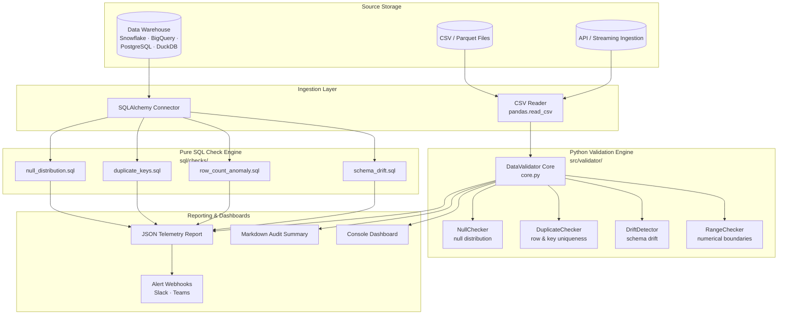

# Data Quality Validator

[](https://github.com/bighnaraj2008-ai/data-quality-validator/actions)
[](#)
[](https://www.python.org/)
[](https://opensource.org/licenses/MIT)
[](https://flake8.pycqa.org/)
[](#)

A high-performance, modular data validation and quality assurance framework designed for modern data engineering pipelines.

## Overview

`data-quality-validator` delivers declarative, automated data quality testing for data ingestion and ETL/ELT pipelines. It provides dual-mode validation:
- **In-Memory Engine**: High-throughput validation across Pandas / PyArrow dataframes.
- **In-Database SQL Engine**: Pure SQL check templates for direct execution in data warehouses (Snowflake, BigQuery, PostgreSQL, DuckDB, SQLite).

### Key Features
- **Null Value Inspection**: Quantifies missing data against configurable threshold ratios.
- **Duplicate Detection**: Identifies row-level duplicates and candidate primary key collisions.
- **Schema Drift Monitoring**: Detects missing columns, unmapped additions, and data type shifts.
- **Range & Boundary Verification**: Validates numerical bounds and statistical bounds.
- **Declarative YAML Rules**: Flexible configuration with environment variable override support.
- **Audit Reports**: Produces machine-readable JSON metrics and markdown summaries.

---

## Architecture & Data Flow

Datasets flow from source storage through Python validators and pure SQL check engines to final reporting dashboards.

### Component Diagram



For full sequence diagrams and detailed architectural notes, see [`docs/ARCHITECTURE.mmd`](docs/ARCHITECTURE.mmd) and [`docs/ARCHITECTURE_REFACTOR.md`](docs/ARCHITECTURE_REFACTOR.md).

---

## Declarative Rule Authoring

Validation rules are authored in clean, declarative YAML format. Rules configure check thresholds, non-nullable assertions, uniqueness keys, and webhook targets.

```yaml
version: "1.0"
environment: "production"

thresholds:
  default_null_threshold: 0.05
  strict_schema: true
  allow_duplicates: false

rules:
  null_checks:
    non_nullable: [id, email]
    column_thresholds:
      phone_number: 0.20
  ranges:
    age:
      min: 0
      max: 120
```

For full syntax reference, per-column overrides, severity mapping, and alert webhook setup, see the [Rule Authoring Guide](docs/RULE_AUTHORING.md).

---

## Pure SQL Check Catalog

When validating datasets exceeding RAM limits or residing directly in cloud data warehouses, `data-quality-validator` provides parameter-bound SQL check templates under `sql/checks/`.

| Check Name | SQL Template | Detects |
|:-----------|:-------------|:--------|
| Null Distribution | `null_distribution.sql` | Missing value ratios exceeding thresholds |
| Primary Key Uniqueness | `duplicate_keys.sql` | Duplicate primary keys and composite key collisions |
| Row Count Anomaly | `row_count_anomaly.sql` | Record count deviations outside expected min/max |
| Schema Drift | `schema_drift.sql` | Missing columns, unmapped additions, and type mismatches |

For query templates, dialect compatibility matrices (Postgres, SQLite, Snowflake, BigQuery, DuckDB), and execution examples, see the [Pure SQL Check Catalog](docs/SQL_CHECK_CATALOG.md) and [SQL Checks Guide](docs/SQL_CHECKS_GUIDE.md).

---

## Quickstart Guide

### 1. Installation

```bash
git clone https://github.com/bighnaraj2008-ai/data-quality-validator.git
cd data-quality-validator

python -m venv venv
# Linux / macOS
source venv/bin/activate
# Windows PowerShell
.\venv\Scripts\Activate.ps1

pip install -e .
```

### 2. Running Data Validation

```bash
# Validate dataset against YAML configuration
python scripts/run_validation.py --data sample_data.csv --config src/config/validator_config.yaml

# Generate JSON execution telemetry report
python scripts/generate_report.py --input sample_data.csv --output reports/validation_report.json --format json
```

### 3. Running Unit Tests

```bash
pytest tests/ -v
```

---

## Python API Reference

Embed `data-quality-validator` directly into your data pipelines and ETL scripts:

```python
import pandas as pd
from src.validator.core import DataValidator
from src.config.loader import ConfigLoader

# Load declarative rules with environment overrides
config = ConfigLoader.load("src/config/validator_config.yaml")

# Initialize orchestrator
validator = DataValidator(config=config)

# Execute checks
df = pd.read_csv("sample_data.csv")
report = validator.validate(df, dataset_name="orders_landing")

print(f"Status: {report.overall_status.value}")
print(f"Passed: {len(report.passed_checks)} | Failed: {len(report.failed_checks)}")
```

For complete class hierarchies, method signatures, and exceptions, see the [Python API Reference](docs/API_REFERENCE.md).
